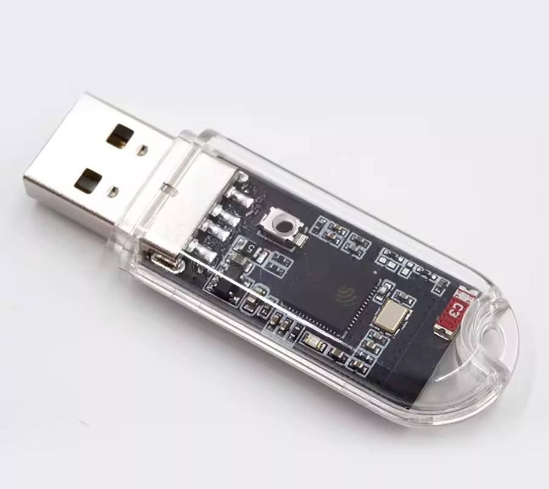

# ESP-BadUSB-S3-Key

BadUSB firmware for the **ESP32-S3-Dongle / ESP32-S3-Key**: a USB-A stick board (schematic marking `ESP32-S3-Dongle v1.0g`) with one blue LED, one button, and a microSD slot.



## Flash it in your browser

No toolchain or command line needed. The web flasher writes the latest release image to the chip over WebSerial. Everything happens locally, and nothing is uploaded.

### → https://qwavey.github.io/ESP-S3-Key-BadUSB/

Use Chrome or Edge. The page also takes a raw `.bin` or an `.espkg` bundle, and it can flash several devices in one session. It is part of the [QWavey flashers hub](https://qwavey.github.io/flashers/).

## Board

| Function | GPIO | Notes |
|---|---|---|
| Onboard LED | GPIO1 | Single blue LED, active-HIGH via `GPIO1 → 1 kΩ → LED → GND`, driven with PWM. |
| Button | GPIO0 | `S1` to GND, active-LOW. Short press stops a running script; 10-second hold factory-resets. |
| microSD | CS 34, MOSI 35, MISO 37, SCK 36 | Wired for SDMMC (`SD_D3/SD_CMD/SD_D0/SD_CLK`), used here in 1-bit SPI mode. |
| USB | native | ESP32-S3 USB-OTG (TinyUSB HID + MSC composite). Default VID `0x303A`, PID `0x0002`. |

The microSD card must be FAT32. On first boot the firmware creates `/languages`, `/scripts`, `/logs`, `/uploads`, and `/extensions/{hak5,custom}`.

Default AP: **ESP32-BadUSB** / `badusb123` → http://192.168.4.1

## Differences from the DevKitC variant

`GpioLed.h` is a drop-in shim over the `Adafruit_NeoPixel` subset the project uses (`begin`, `setBrightness`, `Color`, `setPixelColor`, `show`). It drives a single GPIO LED instead. Any non-black colour maps to a PWM duty on the blue channel. Every LED status mode (solid, blink, warning, completion) still works, just in blue. `Config.h` pins the LED to GPIO1 and the SD card to 34/35/37/36. There is no `Adafruit_NeoPixel` dependency.

Everything else (web UI, DuckyScript interpreter, WiFi AP, BLE, SD scripts, logging, MSC) is shared with the base project.

## DuckyScript 3.0 and Hak5 extensions

The interpreter implements the DuckyScript 3.0 corpus used by the official [`usbrubberducky-payloads`](https://github.com/hak5/usbrubberducky-payloads) extensions. That covers `EXTENSION`/`END_EXTENSION` framing, `IMPORT`, `RUN_EXTENSION`, `FUNCTION`, `DEFINE`/`IF_DEFINED_TRUE`, `REM_BLOCK`, `STRING_BASH`/`STRING_POWERSHELL`, `BUTTON_DEF`, `WAIT_FOR_*`, `HIDE_PAYLOAD`/`RESTORE_PAYLOAD`/`STOP_PAYLOAD`, `SAVE_HOST_KEYBOARD_LOCK_STATE`, `INJECT_MOD`, and the `$_OS`, `$_CAPSLOCK_ON`, and other `$_`-prefixed built-ins.

Two extension folders live on the SD card:

- `/extensions/hak5/`: Hak5-strict semantics inside `EXTENSION` blocks. `ATTACKMODE STORAGE` drops HID, matching Hak5's spec.
- `/extensions/custom/`: this project's semantics. `STORAGE` keeps HID, so a typo doesn't lock you out of typing recovery scripts.

An empty-body `EXTENSION os_detect / END_EXTENSION` (or the collapsed `EXTENSION os_detect ˅` marker) makes Pass 0 load the body from the SD card inline, so later `DETECT_OS` calls resolve. The filename match is case-insensitive. See `ESP-BadUSB-S3-Key/DuckyInterpreter.cpp` for the preprocessor.

## ATTACKMODE (Hak5-compatible)

```
REM Keyboard only
ATTACKMODE HID VID_046D PID_C31C

REM Keyboard + storage. STORAGE keeps HID by default (no lockout on typo)
ATTACKMODE HID STORAGE VID_046D PID_C31C
ATTACKMODE STORAGE

REM Storage only, explicit. No keyboard
ATTACKMODE STORAGE_ONLY

REM Storage off, keep HID
ATTACKMODE OFF
```

Changing the composition (HID ↔ STORAGE) or the identity (VID/PID) saves the current script to `/temp_resume.txt` and reboots the ESP. `setup()` picks up the resume file and re-runs it after the new descriptor is live.

**Hak5 divergence:** in Hak5's implementation, `ATTACKMODE STORAGE` is storage-only with no keyboard. Here, `STORAGE` alone keeps HID, because a typo that silently locks you out of the recovery path is worse than the divergence. Use `STORAGE_ONLY` or `NO_HID` for the classic behaviour.

## SIZE

Report a stick capacity to the host:

```
SIZE_22_GB
ATTACKMODE HID STORAGE          REM standalone form
ATTACKMODE HID STORAGE SIZE_5000_KB
```

If a request is larger than the physical SD card, it is clamped, and the request shows up on the dashboard as `lastError`.

## HID stealth

`HID_ATTACH` and `HID_DETACH` show or hide the keyboard during a script. With Settings → Silent Startup enabled, the device presents no HID at boot, so Windows doesn't play its connect chime. The keyboard attaches only while a script runs or Live typing is active, and detaches afterwards.

It works in three layers, with no eFuse and no hardware mod:

1. A C++ constructor at `.init_array` priority 101 (in `USBManager.cpp`) runs during the C runtime static-init pass, before `main()` and `setup()`. It sets `USB_SERIAL_JTAG.conf0.pad_pull_override = 1` with all D+/D- pull-up bits at 0. That is the electrical signal telling any USB host that no device is there. It is the earliest hook Arduino and ESP-IDF expose.
2. Setup step 0 reads the saved `silent_boot` NVS preference and re-asserts the same override, in case something between the constructor and setup disturbed it.
3. `silentRestorePadsForUsb()` clears the override on non-silent boots, or when `ensureHidReady()` asks to bring HID online. The USB PHY pads are never disabled, because that broke `tud_hid_ready` after enumeration. Only the pull-up-override bit toggles.

The ESP32-S3 ROM asserts the D+ pull-up about 1 ms after power-up. No user code can run before that. The constructor removes the pull-up quickly enough that Windows never completes enumeration. Nothing appears in Device Manager, and the aborted attach doesn't play the chime. If a future OS chimes on that nanosecond D+ pulse, only burning the `DIS_USB_JTAG` eFuse or an external USB switch (the O.MG-cable approach) will silence it.

## Live typing

Type in the browser and every keystroke goes to the host over HID in real time. Enter, Backspace, Tab, Esc, arrows, and Ctrl/Alt/Gui combos are all included. Endpoint: `POST /api/live-type`.

## `.espkg` update packages

A `.espkg` bundles the SD website files and, optionally, a firmware image. In the web UI, go to Settings → *Firmware Update*, pick the file, and press *Upload & Apply*. The device writes the SD files first, then flashes the firmware over the air and reboots. Do not unplug the device during the update.

Build one with the helper:

```
python tools/build_espkg.py --web "Website [ESP SD]" \
  --firmware build/ESP-BadUSB-S3-Key.ino.bin \
  --version 4.35 -o dist/full.espkg
```

Or compile, package, and flash in one step:

```
python tools/build_espkg.py --force-compile --flash-after-done \
  --port COM6 -o dist/full.espkg
```

Container format: the `ESPKG\x01` magic (6 bytes), a `uint32` manifest length, the manifest JSON (`{version, sd:[{path,size,crc32}], fw:{size,crc32}}`), then the payloads concatenated, SD files first and firmware last. SD files come first because flashing the firmware reboots the chip.

## Build and flash

Arduino ESP32 core 3.x. Board **ESP32S3 Dev Module** with:

```
USB Mode:          USB-OTG (TinyUSB)
USB CDC On Boot:   Disabled
Flash Size:        8MB
Partition Scheme:  8M with spiffs (3MB APP / 1.5MB SPIFFS)
PSRAM:             Disabled
```

FQBN:

```
esp32:esp32:esp32s3:USBMode=default,FlashSize=8M,CDCOnBoot=default,UploadMode=default,PartitionScheme=default_8MB,PSRAM=disabled
```

## Releases

Every tagged release attaches `dist/badusb-full-<ver>.espkg`, which you can load straight into the web UI updater. Source tarballs are attached automatically. See [releases](https://github.com/QWavey/ESP-S3-Key-BadUSB/releases).
